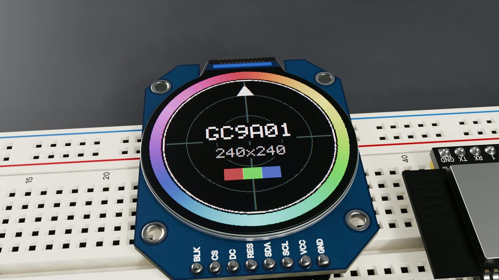
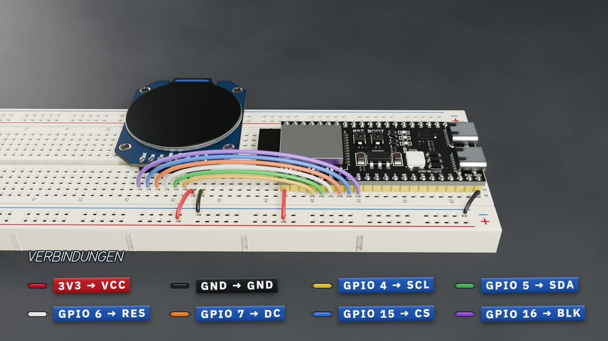

# ESP32-S3 + rundes TFT-Display (GC9A01)

**▶ Videos herunterladen:** [quer 1920×1080](https://github.com/3zsbg/esp32-s3-tft-projekt/releases/download/v1/ESP32-S3-Projekt.mp4) · [hochkant 1080×1920](https://github.com/3zsbg/esp32-s3-tft-projekt/releases/download/v1/ESP32-S3-Projekt-Hochkant.mp4)

Kurzes 3D-Video (37 Sekunden): ein ESP32-S3-DevKit kommt aufs Steckbrett, danach wird das runde 1,28"-TFT-Display GC9A01 (240×240) angeschlossen und zeigt sein Testbild.

## Videos

Beide Fassungen liegen unter [Releases](../../releases/latest):

| Datei | Format |
|---|---|
| `ESP32-S3-Projekt.mp4` | quer, 1920×1080, 30 fps |
| `ESP32-S3-Projekt-Hochkant.mp4` | hochkant, 1080×1920, 30 fps (Shorts, Reels, TikTok) |

## Verbindungen

| ESP32-S3 | GC9A01 |
|---|---|
| 3V3 | VCC |
| GND | GND |
| GPIO 4 | SCL |
| GPIO 5 | SDA |
| GPIO 6 | RES |
| GPIO 7 | DC |
| GPIO 15 | CS |
| GPIO 16 | BLK |
